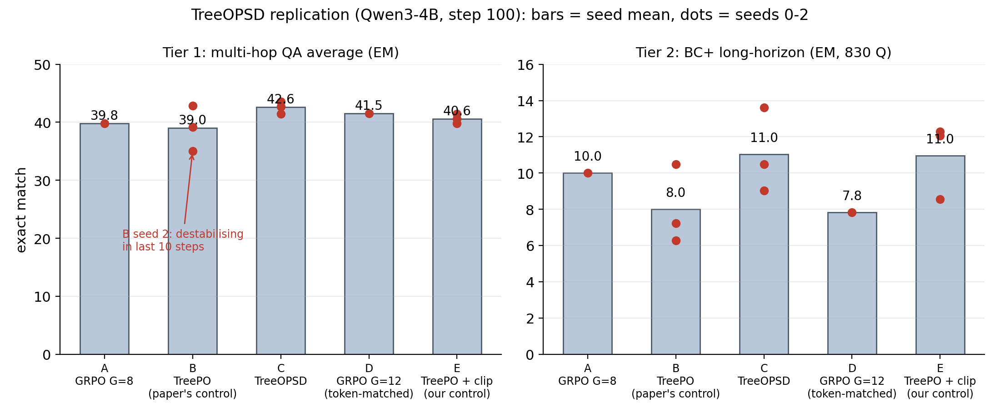

# TreeOPSD replication: boundedness, not the posterior

A preregistered replication of TreeOPSD, *Tree-Aware Posterior Distillation
for Long-Horizon Agentic Reinforcement Learning*
([arXiv:2610.23181](https://arxiv.org/abs/2610.23181), Tsinghua), on
Qwen3-4B-Thinking-2507. Five arms, three seeds, frozen retrieval, fixed
step-100 checkpoint, run on two DGX Station GB300 systems.



## Headline result

Against the paper's own control (unclipped TreePO), TreeOPSD passes both
preregistered bars: pooled exact-match gaps of +3.76 [+2.81, +4.74] on a
four-set multi-hop QA average and +3.45 [+2.13, +4.78] on BC+ (830
questions, long-horizon track). Seed-level intervals at n=3 include zero,
and about half the gap comes from one control seed destabilising late in
training.

Against an added control, the same TreePO with ordinary ratio clipping,
the gaps are QA +1.98 [+1.03, +2.94] (per-seed 3.78, 2.10, 0.05) and
BC+ +0.08 [-1.24, +1.41]. The posterior term changes the per-update
target by a median 1.05% at the paper's dose; a preregistered dose sweep
shows no growing accuracy gap, and at 4x dose the unclipped control
collapses in training in 2 of 2 seeds while both bounded variants train
through. The budget match for tree sampling holds in generated tokens
(1.03x GRPO) but not in trained tokens (1.48x). Best-checkpoint selection
shrinks the gap toward zero.

Verdict: the supported mechanism in this setting is update boundedness,
not posterior credit assignment. Bounded tree backup itself trains a 4B
search agent effectively, and the clipped variant has the smallest seed
variance of any arm (0.80 EM sd).

## Layout

| Path | Contents |
|---|---|
| `PREREG-EXP1.md` | Preregistration, including pass/kill bars (one pre-training amendment) |
| `PAPER.md`, `DESIGN.md`, `DATA.md` | Paper extraction, study design, data provenance |
| `ANALYSIS-FINAL-20261024.md` | Final analysis; every number in the note traces to `results/` |
| `paper/main.tex` | arXiv replication note (submission in progress) |
| `results/` | The three seed packages (per-run EM, paired bootstraps, seed statistics) |
| `treeopsd/`, `retriever/`, `env/` | Training and evaluation code (verl extensions, frozen retriever, container) |
| `scripts/` | Run, eval, and packaging scripts. `scripts/seed_package.py` computes the result packages |
| `experiments/worklog.md` | Chronological experiment log |
| `correspondence/` | Complete ruling/response log between the research session and the station controller |
| `figures_x/` | Figures and the posted X texts |

## Recomputing the headline numbers

```
python3 scripts/seed_package.py --interim <interim-dir> --out <out-dir> \
  --pair E,C --gb300-runs exp1-treeopsd-s0,exp1-treeopsd-s1
```

Per-question rows are paired by prompt sha1. Intervals are paired
bootstraps (10,000 resamples, stratified by benchmark). Held-out eval
artifacts and model checkpoints are not in this repository; result
packages under `results/` are the scored summaries of record.

## Links

- Announcement post and thread: https://x.com/SJRonanMD/status/2114214898964332565
- arXiv note: [ID added on announcement]

## Notes on this release

Station hostnames and internal IP addresses were replaced with
placeholders (`STATION_LEFT`, `STATION_IP`, `user@`). Nothing else was
changed. Experiments were designed and directed by Stephen J. Ronan
(RonanLabs) and executed with AI-agent assistance under the file-based
controller protocol preserved in `correspondence/`.
