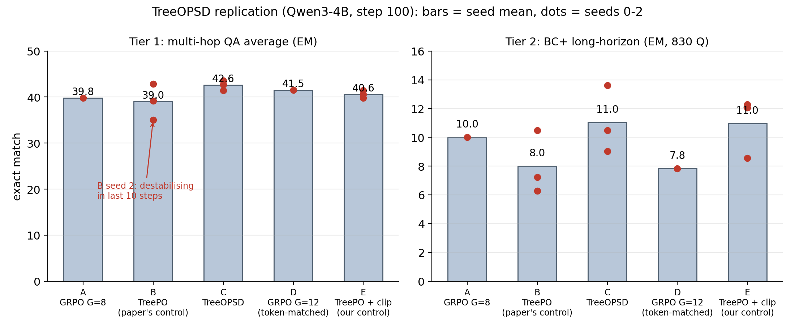

# A Preregistered Replication of TreeOPSD on Qwen3-4B

A preregistered replication of TreeOPSD, *Tree-Aware Posterior Distillation
for Long-Horizon Agentic Reinforcement Learning*
([arXiv:2610.23181](https://arxiv.org/abs/2610.23181), Tsinghua), on
Qwen3-4B-Thinking-2507. Five arms, three seeds, frozen retrieval, fixed
step-100 checkpoint, run on two DGX Station GB300 systems.



## Headline result

Against the paper's own control (unclipped TreePO), TreeOPSD passes the F1
EM bars on pooled question-bootstrap intervals: exact-match gaps of +3.76 [+2.81, +4.76] on a
four-set multi-hop QA average and +3.45 [+2.17, +4.78] on BC+ (830
questions, long-horizon track). Seed-level intervals at n=3 include zero,
and about half the gap comes from one control seed destabilising late in
training. This is not an F1 mechanism pass: the preregistered M1
inactivity rule fired, declaring the posterior term inactive at this dose
whatever the EM shows.

Against an added control, the same TreePO with ordinary ratio clipping,
the gaps are QA +1.98 [+1.03, +2.94] (per-seed 3.78, 2.10, 0.05) and
BC+ +0.08 [-1.24, +1.41]. The posterior term changes the per-update
target by a median 1.05% at the paper's dose, below the 2% M1 line. In the
preregistered dose sweep the only reported accuracy point before collapse
is one E=8 subset gap of -0.8 EM with no interval. At E=16 the unclipped
control failed in training on both seeds (subset scores 0.0/0.0 and
17.8/0.0), while the clipped TreePO and TreeOPSD runs reported completed.
The budget match for tree sampling holds in generated tokens
(1.03x GRPO) but not in trained tokens (1.48x). Best-checkpoint selection
shrinks the gap toward zero. Against the preregistered 1.15x line,
generated tokens pass and trained tokens fail; full-100-step tool-call
and GPU-time measures were not recorded, so that part of F2 is not
evaluable and F2 has no established pass. The paper labels the separate
10-step smoke-run indications explicitly.

Adding ordinary clipping to the same tree backup removed the instability
seen in the unclipped control and matched TreeOPSD on BC+. This supports
that narrower boundedness finding; it does not establish that any bound
works. Clipped TreePO's three-seed QA-average sd was 0.80 EM and its BC+
sd was 2.09 EM.

Read the [revised paper (PDF)](paper/main.pdf).

## Layout

| Path | Contents |
|---|---|
| `PREREG-EXP1.md` | Preregistration, including pass/kill bars (one pre-training amendment) |
| `PAPER.md`, `DESIGN.md`, `DATA.md` | Paper extraction, study design, data provenance |
| `ANALYSIS-FINAL-20261024.md` | Final analysis; every number in the note traces to `results/` |
| `paper/main.tex` | arXiv replication note (submission in progress) |
| `results/` | The three seed packages (per-run EM, paired bootstraps, seed statistics) |
| `treeopsd/`, `retriever/`, `env/` | Training and evaluation code (verl extensions, frozen retriever, container) |
| `scripts/` | Run, eval, and packaging scripts. `scripts/seed_package.py` computes the result packages |
| `experiments/worklog.md` | Chronological experiment log |
| `correspondence/` | Complete ruling/response log between the research session and the station controller |
| `figures_x/` | Figures and the posted X texts |

## Recomputing the headline numbers

```
python3 scripts/seed_package.py --interim <interim-dir> --out <out-dir> \
  --pair E,C --gb300-runs exp1-treeopsd-s0,exp1-treeopsd-s1
```

Per-question rows are paired by prompt sha1. Intervals are paired
bootstraps (10,000 resamples, stratified by benchmark). Held-out eval
artifacts and model checkpoints are not in this repository; result
packages under `results/` are the scored summaries of record.

## Links

- Announcement post and thread: https://x.com/SJRonanMD/status/2114214898964332565
- arXiv note: [ID added on announcement]

## Notes on this release

Station hostnames and internal IP addresses were replaced with
placeholders (`STATION_LEFT`, `STATION_IP`, `user@`). Nothing else was
changed. Experiments were designed and directed by Stephen J. Ronan
(RonanLabs) and executed with AI-agent assistance under the file-based
controller protocol preserved in `correspondence/`.
